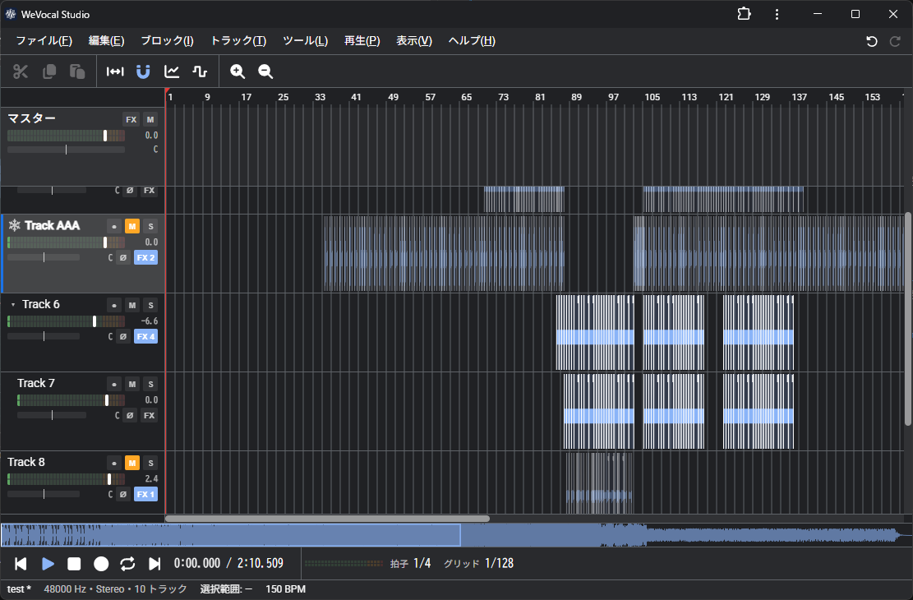
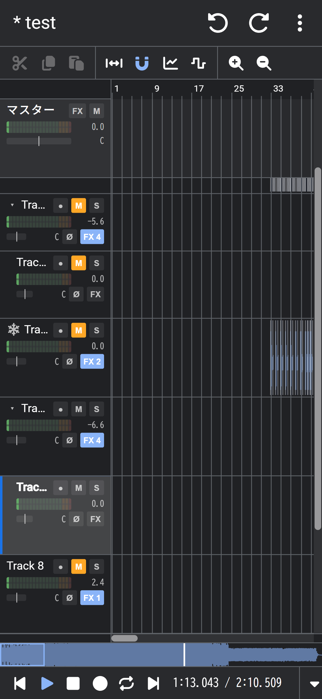

# WeVocal Studio
WeVocal Studioは、Webブラウザ上でトラックにブロックとして音声やMIDIなどを並べて編集する総合音声ツール(DAW)である。

- https://wevocalstudio.pitan76.net/




インストールは不要で音声ファイルはサーバーへ送信せず、処理はすべてブラウザ内で実行する。

## できること
| 分類 | 機能 |
| --- | --- |
| 配置 | 音声ファイルをトラックに波形ブロックとして並べる、移動、分割、削除 |
| ブロック | 波形ブロック、MIDIブロック、音量、ピッチ（WeVocalSynth と同じ処理方式）、エフェクト、フェード、ミュート |
| 加工 | ピッチ変更（0.01半音単位）、時間伸縮、フォルマント保持、移動、ボーカルと楽器のモード、音の種類に合わせて選べる処理方式（Vesola、Solis、Phasera、HPSS など）、逆再生 |
| ピッチ | 範囲の音程の表示と最寄りの音名に合わせる、ピッチ曲線の表示とペンでの描き直し、半音上下、平らにする、音階に揃える、ビブラート、MIDI の音程を当てはめる |
| 編集 | 範囲選択（複数可）、切り取り、コピー、貼り付け（ピッチの曲線にも）、無音の挿入、音量編集、音量とフォルマントの曲線を描く、音符ブロックの移動と伸縮、マーカー、元に戻す、やり直す、操作履歴 |
| トラック | 音量、パン、ミュート、ソロ |
| 音声の作成 | 声、楽器の音色で、単音または MIDI のメロディから音声を作成（フォルマントと音量を指定、作成前に試聴）、選択範囲を MIDI の音符に並べる、録音 |
| テンポ | BPM自動解析、拍の線と拍への吸着、BPM変更に合わせた全体の伸縮 |
| 確認 | 加工後の試聴、スライダーの操作を即座に反映するループ試聴、原音との比較、帯パネルごとの表示（波形、ピッチ、音量、フォルマント） |
| 保存 | WAV / FLAC / MP3 / Opus / AAC の書き出し、選択範囲をフォルダーへ保存、プロジェクトの保存（.wvst）、作業の自動保存と復元、保存先の選択と最近使用したファイル（Chrome、Edge） |
| その他 | パソコンとスマホに対応、オフラインで使用できる（PWA）、.wvst をダブルクリックで開く、日本語、英語、韓国語、中国語（簡体字、繁体字）、ミニマップ、キーの割り当て |
| 試験的機能 | 和音を分離、声から五十音を作る、GPU での加工、VSTプラグインエミュレータ |
| 追加機能 | ボーカル抽出、スペクトログラム、動画の書き出し（使用するときだけダウンロードする） |
| エフェクト | イコライザー、ディレイ、リバーブ、コンプレッサー、コーラスなど標準付属、Web Audio Modules対応 |

### 追加機能と関連ツール
追加機能の本体は、別のリポジトリのツールである。どれも単体の Web ツールとして使用でき、画面を持たないライブラリとして WeVocalSynth の追加機能にも組み込んでいる。

| ツール | 単体での用途 | WeVocalSynth での追加機能 |
| --- | --- | --- |
| [WeVocalExtractor](https://github.com/PTOM76/wevocalextractor) | 曲からボーカルと伴奏を取り出す | ボーカル抽出 |
| [WeVocalAnalyzer](https://github.com/PTOM76/wevocalanalyzer) | 声の解析（F0、フォルマント、スペクトログラム、歌詞の文字化） | スペクトログラム |
| [WeVocalConverter](https://github.com/PTOM76/wevocalconverter) | 音声ファイルの形式の変換、動画の書き出し | 動画の書き出し |

### 関連リポジトリ
| リポジトリ | 備考 |
| --- | --- |
| [wevocalsynth](https://github.com/PTOM76/wevocalsynth) | WeVocalSynth（音声加工ツール） |
| [wevocalextractor](https://github.com/PTOM76/wevocalextractor) | WeVocalExtractor（ボーカル抽出） |
| [wevocalanalyzer](https://github.com/PTOM76/wevocalanalyzer) | WeVocalAnalyzer（スペクトログラム、文字起こし） |
| [wevocalconverter](https://github.com/PTOM76/wevocalconverter) | WeVocalConverter（動画出力） |
| [wevocal-lib](https://github.com/PTOM76/wevocal-lib) | WeVocal Lib (ライブラリ) |
| [pevenmui](https://github.com/PTOM76/pevenmui) | PevenMUI (UIコンポーネント) |
| [wevocal-vstbridge](https://github.com/PTOM76/wevocal-vstbridge) | WeVocal VST-Bridge (VSTプラグインエミュレータ) |
| [wevocal-plugin-sdk](https://github.com/PTOM76/wevocal-plugin-sdk) | WeVocal Plugin SDK (プラグイン開発キット) |
| [wevocal-webpage](https://github.com/PTOM76/wevocal-webpage) | WeVocalシリーズの公式サイト |

## 技術スタック
| 項目 | 内容 |
| --- | --- |
| 画面 | React + TypeScript + MUI（[PevenMUI](https://github.com/PTOM76/pevenmui)、Vite） |
| 音声 | Web Audio、Rust（WebAssembly）、[wevocal-lib](https://github.com/PTOM76/wevocal-lib) |
| 再生 | Web Audio API、AudioWorklet |

## セットアップ
```bash
git clone --recursive git@github.com:PTOM76/wevocalstudio.git
cd wevocalstudio
npm install
npm run dev
```

次のフォルダーは submodule。`--recursive` を付け忘れたら `git submodule update --init` で取得する。

| フォルダー | 内容 |
| --- | --- |
| `extractor/` | WeVocalExtractor（ボーカル抽出） |
| `analyzer/` | WeVocalAnalyzer（スペクトログラム、文字起こし、音声解析） |
| `converter/` | WeVocalConverter（動画出力） |
| `wevocal-lib/` | 共有の信号処理と、音声の読み込み、書き出し、音声処理アルゴリズム、プラグイン |
| `pevenmui/` | 画面の部品 |

`--recursive` だと `extractor/pevenmui/` なども取得されるが、修正するのはルートの `pevenmui/` の方。紛らわしければ、それぞれのフォルダーで `todo setup:nested` を実行して隠す。追加機能を開発サーバーで試すときは、先に `npm run build:addons:dev` を実行する。

音声処理（`dsp/`）を変更するときだけ Rust が必要になる。ビルド済みの `.wasm` をリポジトリに含めているので、画面だけなら Node.js だけで動作する。

[Todofile](https://github.com/Pitan76/Todofile)を導入している場合は、クローン後、`todo setup` と `todo dev` で同様のセットアップが可能。

詳しくは [セットアップ](docs/SETUP.md)

### 補足
`wevocalstudio/` の隣に WeVocalSynth（`../wevocalsynth/`）があれば、同時開発のためにその中のものを先に利用する。submodule を Synth の中のコミットとそろえるには `todo update:modules` を実行する

GitHub Pages へは、main に push すると GitHub Actions（`.github/workflows/deploy.yml`）が公開する。

## コードの場所
- 画面: `src/`
  - 組み立ては `src/App.tsx`、状態と操作は `src/hooks/useEditor.ts`
  - 言語ファイル: `src/i18n/`
- 音声処理（Rust）: `dsp/src/`
  - テスト: `dsp/src/tests/`

## ドキュメント
<!-- - Wiki: https://doku.wikichree.com/wevocalstudio/start -->

| ドキュメント名 | リンク先 |
| --- | --- |
| 使い方（利用者向け） | [docs/MANUAL.md](docs/MANUAL.md) |
| 開発環境構築 | [docs/SETUP.md](docs/SETUP.md) |
<!-- | 要件定義 | [docs/REQUIREMENT.md](docs/REQUIREMENT.md) | -->
<!-- | 決定事項 | [docs/DECISIONS.md](docs/DECISIONS.md) | -->
| コーディング規約 | [docs/CODING.md](docs/CODING.md) |
| アーキテクチャ設計 | [docs/ARCHITECTURE.md](docs/ARCHITECTURE.md) |
| ファイル構成 | [docs/STRUCTURE.md](docs/STRUCTURE.md) |
<!-- | 機能の仕組み | [docs/INTERNALS.md](docs/INTERNALS.md) | -->
<!-- | プロジェクトファイルの形式 | [docs/PROJECT_FORMAT.md](docs/PROJECT_FORMAT.md) | -->
| アルゴリズム | [docs/ALGORITHM.md](docs/ALGORITHM.md) |
<!-- | 速さの計測 | [docs/PERFORMANCE.md](docs/PERFORMANCE.md) | -->
<!-- | 追加機能とボーカル抽出 | [docs/EXTRACTOR.md](docs/EXTRACTOR.md) | -->
| バージョン履歴 | [docs/VERSION.md](docs/VERSION.md) |
<!-- | ドキュメントの書き方 | [docs/WRITING.md](docs/WRITING.md) | -->
<!-- | 小ネタ | [docs/TIPS.md](docs/TIPS.md) | -->

## License
This project is licensed under the MIT License.
