# 使い方
WeVocal Studio の操作方法をまとめた説明書。 
音声ファイルをトラックに並べ、ピッチ（音の高さ）や速度を変更して、書き出すまでの流れと、各機能の使い方を記載する。

## 目次

- [用語](#用語)
- [画面](#画面)
  - [パソコン](#パソコン)
  - [ツールバー](#ツールバー)
  - [スマホ](#スマホ)
- [基本の流れ](#基本の流れ)
- [対応ファイル](#対応ファイル)
- [保存とデータ](#保存とデータ)
- [波形ブロックの操作](#波形ブロックの操作)
  - [選択](#選択)
  - [移動と長さの変更](#移動と長さの変更)
  - [分割と無音での区切り](#分割と無音での区切り)
  - [プロパティ](#プロパティ)
  - [編集バー](#編集バー)
  - [右クリックのメニュー](#右クリックのメニュー)
- [範囲の操作](#範囲の操作)
- [ピッチと速度](#ピッチと速度)
  - [ピッチをなめらかにつなぐ](#ピッチをなめらかにつなぐ)
  - [逆再生](#逆再生)
  - [ビブラートを付ける](#ビブラートを付ける)
  - [ピッチカーブ](#ピッチカーブ)
- [音量とエンベロープ](#音量とエンベロープ)
- [確定](#確定)
- [トラック](#トラック)
  - [サブトラック](#サブトラック)
  - [FX](#fx)
  - [フリーズ](#フリーズ)
  - [センド](#センド)
  - [オートメーション](#オートメーション)
  - [マスタートラック](#マスタートラック)
- [再生](#再生)
- [テンポと拍の線](#テンポと拍の線)
  - [スナップ](#スナップ)
- [マーカー](#マーカー)
- [録音](#録音)
- [MIDI ブロックと音源](#midi-ブロックと音源)
  - [MIDI キーボード](#midi-キーボード)
- [プラグインによる処理と解析](#プラグインによる処理と解析)
- [ボーカル抽出](#ボーカル抽出)
  - [和音の分離（試験的）](#和音の分離試験的)
- [音声の作成](#音声の作成)
- [MIDI の音符に並べる](#midi-の音符に並べる)
- [一音ずつ切り出す](#一音ずつ切り出す)
- [解析の欄](#解析の欄)
  - [配置](#配置)
- [操作履歴](#操作履歴)
- [プロジェクトのタブ](#プロジェクトのタブ)
- [画面の端の欄（ドック）](#画面の端の欄ドック)
- [書き出し](#書き出し)
- [設定](#設定)
- [キーボード操作](#キーボード操作)
- [困ったとき](#困ったとき)

## 用語

| 用語 | 意味 |
| --- | --- |
| 波形ブロック | トラックに並べる音の単位。元の音、位置、長さ、音量、ピッチ、速度などを持つ |
| 元の音 | 読み込んだ音声ファイル、録音した音。波形ブロックはこれを参照するだけで、中身は書き換えない |
| トラック | 波形ブロックを時間軸に並べる行。音量、パン、ミュート、ソロ、FX の列を持つ |
| マスタートラック | 全トラックを混ぜたあとに掛ける行（一番上） |
| ピッチ | 音の高さ。「半音」単位で上げ下げする（12 半音 = 1 オクターブ、1 半音 = 100 セント） |
| フォルマント | 声質（声の太さや細さ）を決める成分 |
| 範囲 | 時間軸でドラッグして選択した部分 |
| 編集カーソル | 赤い線。クリックした位置で、貼り付けや分割の位置になる。再生では動かない |
| 再生カーソル | 再生中の位置を示す線 |
| グリッド | 拍と小節（または秒）に引く目盛りの線 |

- 元の音は書き換えない。再生と書き出しのたびに、波形ブロックの値から音を作る
- ピッチや速度を変えた音は、作り終えるまでは元の音で鳴らす。作った音はキャッシュされる
- 複数の波形ブロックを選択している場合、移動、削除、ピッチ、コピー、複製は選択した全部に適用される

## 画面

### パソコン

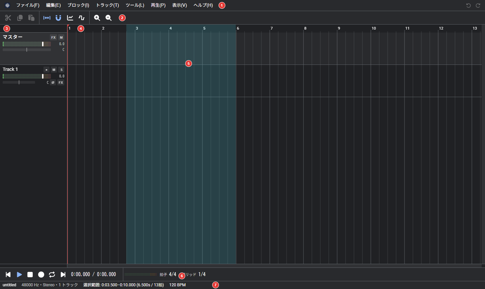

| 番号 | 場所 | 内容 |
| --- | --- | --- |
| 1 | 上部のバー | メニュー、プロジェクト名、元に戻す、やり直し |
| 2 | ツールバー | よく使う操作のボタン（[ツールバー](#ツールバー)） |
| 3 | 時間目盛り | 小節の番号（または秒）。クリックやドラッグで再生位置を移動する |
| 4 | トラックの欄（左） | トラックの名前、録音待機（●）、ミュート（M）、ソロ（S）、位相の反転（Ø）、FX、音量、パン |
| 5 | 時間軸（右） | 波形ブロックを並べる。範囲の選択、編集カーソルの移動もここで行う |
| 6 | 解析の欄 | スペクトログラムとピッチ（F0）の線。「表示」で切り替える（[解析の欄](#解析の欄)） |
| 7 | ミニマップ | 全体を縮小した波形。枠が現在の表示範囲で、ドラッグで移動する。「表示」で切り替える |
| 8 | 再生のバー | 先頭へ、再生と一時停止、停止、録音、リピート、末尾へ。時間、レベルメーター、拍子、グリッド |
| 9 | ステータスバー | プロジェクト名、形式、範囲、BPM、処理の進み具合 |

設定の「表示」でテーマをライトにすると、明るい色の画面になる。

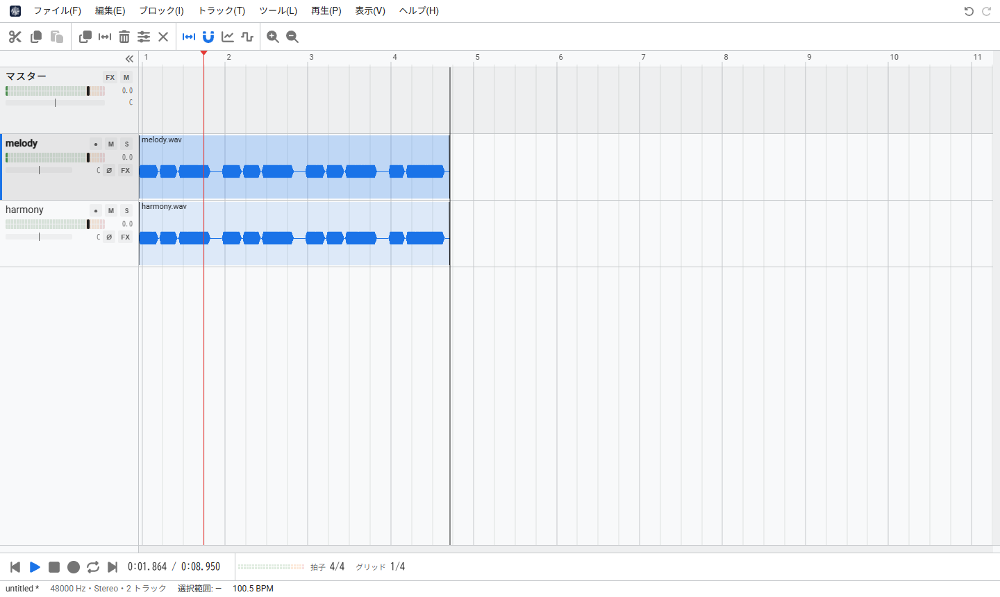

| メニュー | 主な項目 |
| --- | --- |
| ファイル | 新しいウィンドウ、新しいプロジェクト、開く、最近使用したファイル、保存、名前を付けて保存、最適化して保存、音声ファイルを読み込む、書き出す、動画ファイルに書き出す、WeVocalSynth のプロジェクトに書き出す、フォルダーへ保存、設定 |
| 編集 | 元に戻す、やり直す、操作履歴、切り取り、コピー、貼り付け、複製、削除、すべて選択、選択の解除、分割、範囲の両端で分割、無音で区切る、範囲の操作（範囲だけ残す、消して詰める、無音を挿入、繰り返す、新しいトラックへコピー、移動）、マーカー |
| ブロック | プロパティ、ピッチ（上げ下げ、元に戻す、なめらかにつなぐ、ビブラート）、MIDI（追加、読み込み、書き出し、つなぐ、ピアノロール、トラックの音源）、ノーマライズ、逆再生、確定 |
| トラック | トラックを追加、複製、名前の変更、サブトラックを追加、削除、ミュート、ソロ |
| ツール | ボーカル抽出（ボーカルと伴奏、主旋律とハモリ、楽器ごと）、MIDI の音符に並べる、音声を作成、一音ずつ切り出す、プラグインで処理、プラグインで解析 |
| 再生 | 再生、一時停止、範囲を再生、録音、リピート、先頭と末尾へ、テンポを解析、マーカー |
| 表示 | 拡大、縮小、全体を表示、範囲に合わせて拡大、スナップ、再生位置に追従、エンベロープ、オートメーションを編集、拍と小節で表示、解析の欄、レベルメーター、ミニマップ、ステータスバー、配置 |
| ヘルプ | 使い方、ショートカット一覧、更新を確認、ライセンス、このアプリについて |

メニューのキーの割り当ては、メニューの右側に表示される。

### ツールバー

アイコンのみのボタンは、マウスカーソルを合わせると名前が表示される。並ぶボタンは選んでいるものによって変わる。下の画像は波形ブロックを選んでいるとき。

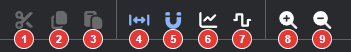

| 番号 | ボタン | 説明 | キー |
| --- | --- | --- | --- |
| 1 | 切り取り | 選んでいる波形ブロックか範囲を切り取る | Ctrl+X |
| 2 | コピー | 選んでいる波形ブロックか範囲をコピーする | Ctrl+C |
| 3 | 貼り付け | 編集カーソルの位置に貼り付ける | Ctrl+V |
| 4 | 複製 | 選んでいる波形ブロックを、すぐ後ろに複製する | Ctrl+D |
| 5 | 分割 | 再生位置で波形ブロックを分ける | S |
| 6 | 削除 | 選んでいる波形ブロックを削除する | Delete |
| 7 | プロパティ | 波形ブロックのプロパティを開く（[プロパティ](#プロパティ)） | F2 |
| 8 | 選択を解除 | 選択を外す | |
| 9 | 再生位置に追従 | 再生中、再生位置が見えるように表示をずらす | F |
| 10 | スナップ | 波形ブロックの移動や範囲の選択を、拍の線に合わせる（[スナップ](#スナップ)） | Alt+S |
| 11 | 音量のエンベロープ | 波形ブロックに音量の線を表示して編集する（[音量とエンベロープ](#音量とエンベロープ)） | E |
| 12 | ピッチのエンベロープ | 波形ブロックにピッチの線を表示して編集する（[ピッチカーブ](#ピッチカーブ)） | Shift+E |
| 13 | 拡大 | 時間軸を横に拡大する | Num + |
| 14 | 縮小 | 時間軸を横に縮小する | Num - |

範囲を選んでいるときは、4〜7 のかわりに「範囲だけ残す」が表示される。

### スマホ

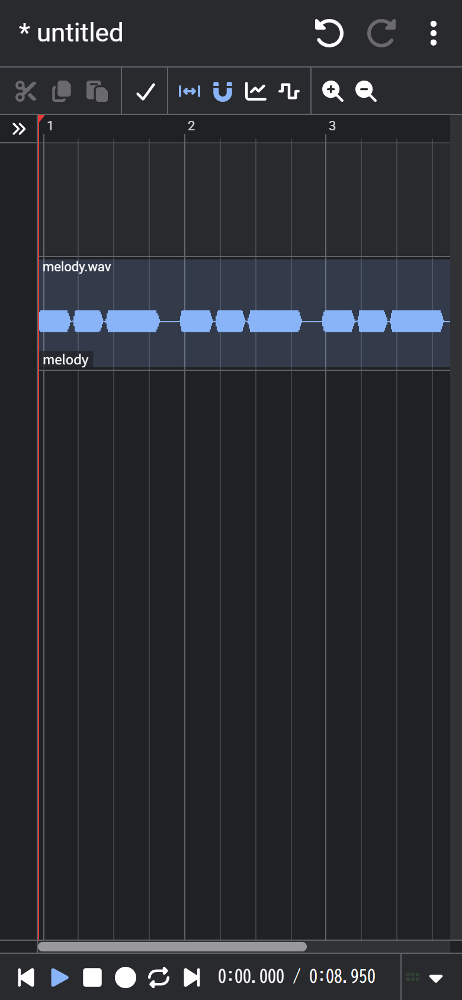 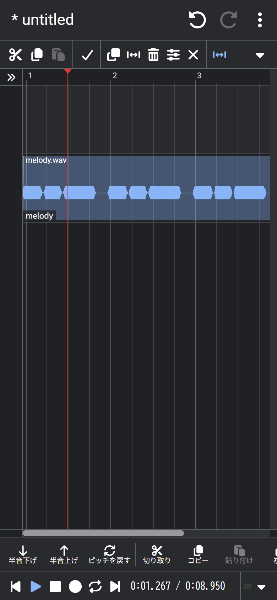

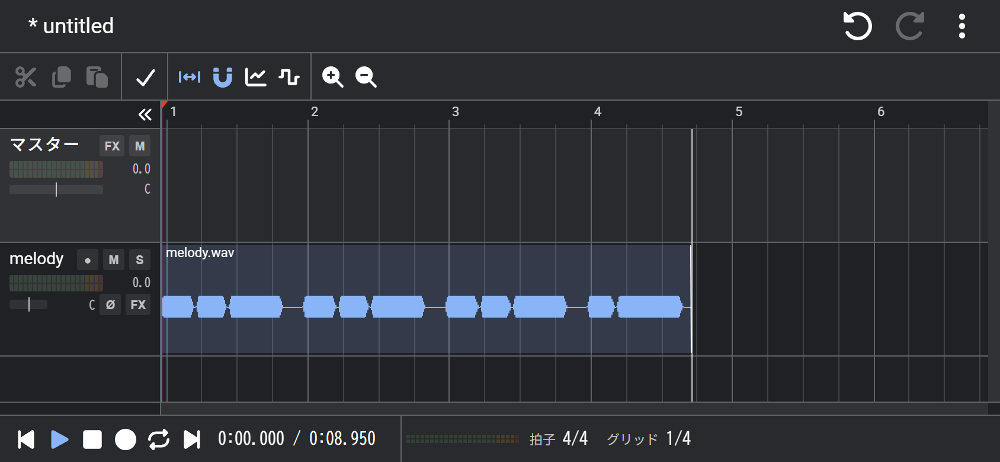

- メニューは上部のバーの ⋮ にまとめられている
- トラックの欄は狭くなり、入りきらない再生のバーの項目は ▼ にしまわれる。目盛りの左の « を押すと、トラックの欄を閉じて時間軸を広く使用できる（» で開く。縦持ちの画面では、最初から閉じている。閉じたかどうかは次回も引き継がれる）
- 波形ブロックか範囲を選択すると、画面の下に編集バーが表示される（[編集バー](#編集バー)）
- 波形ブロックをダブルタップするとプロパティ、長押しするとメニューを開く
- MIDI ブロックは、指でつかんで動かし（縦に動かすとほかのトラックへも移る）、両端をつかんで長さを変えられる（端をつかめる幅は広い）。ダブルタップでピアノロールを開き、長押しすると MIDI ブロックのメニュー（プロパティ、ピアノロール、音源、切り取り、コピー、複製、分割、削除、つなぐ、書き出し）を開く。選ぶと、画面の下の編集バーにも、ピアノロール、音源、つなぐなどのボタンが出る
- 何もない所を長押ししてそのままなぞると、範囲を選択できる（動かさずに指を離すと、その場所のメニューが開く）。長押しして指を離したときのメニューには、押したトラックのミュート、ソロ、名前の変更、複製、削除もある（トラックの欄を閉じているときに使用する）
- 2 本指のピンチで拡大と縮小、なぞると横にスクロールする
- トラックの欄を長押しすると、トラックのメニューを開く
- ピアノロールは、画面いっぱいに開く。選択の道具で、空いている所を指でなぞるとスクロールし、押して離すと音符が足され、長押ししてなぞると枠で選択できる（ペンの道具では、押すと音符が足される）。2 本指のつまみで拡大と縮小、なぞるとスクロールする。音符を長押しすると、削除、コピー、複製のメニューが開く。音符の右端をつかめる幅と、行の高さは、指で操作しやすいよう広い
- iPhone、iPad は、マナーモードでも音が鳴るように再生用の音声セッションに切り替える

## 基本の流れ

1. **読み込む**: 音声ファイルを画面にドラッグ＆ドロップするか、「ファイル」→「音声ファイルを読み込む…」（Insert）で読み込む。空いているトラックか、新しいトラックに波形ブロックとして配置される。トラックの上にドロップすると、その位置に配置される 何も置いていないときは、時間軸の上に「ファイルを選択」「音声を作成」「録音」「最近使用したファイル」の案内が出る
2. **並べる**: 波形ブロックをドラッグして位置を決める。端をドラッグして長さを変更する
3. **加工する**: 波形ブロックを選択し、ピッチ、速度、音量、フェードを変更する（[プロパティ](#プロパティ)）
4. **再生する**: Space で再生と停止を切り替える。再生中に変更した値は、そのまま反映される
5. **書き出す**: 「ファイル」→「書き出す…」（Ctrl+Alt+R）で、音声ファイルとして保存する

作業内容はブラウザ内に自動で保存され、次回起動時に復元される（[保存とデータ](#保存とデータ)）。

## 対応ファイル

| 種類 | 形式 |
| --- | --- |
| 読み込み | ブラウザが再生できる音声（WAV、MP3、AAC、FLAC、Ogg など）。AIFF は WeVocal Studio が直接読み込む |
| プロジェクト | .wvst |
| 書き出し | WAV、FLAC、MP3、AAC、Opus |

## 保存とデータ

- 「プロジェクトを保存」（Ctrl+S）、「名前を付けて保存」（Ctrl+Shift+S）で、プロジェクトのファイル（.wvst）を保存する。「開く」（Ctrl+O）で開く
- 「最適化して保存」で、プロジェクトを軽くした写しを別のファイルに保存する。今のプロジェクトは変わらない。次の項目を選べる
  - 加工の確定: 「確定しない」「ピッチと速度だけ確定」「すべて確定（音量、フェード、エンベロープも）」。確定した波形ブロックは、加工後の音を元の音として保存するので、あとから加工を変えられない。波形ブロックを選んでいれば、選んだものだけを確定できる
  - 使っていない部分を切り落とす: 波形ブロックが使う範囲の外の元の音を捨てる（前後に少し余白を残す）
  - 使っていない元の音を消す: どの波形ブロックも使っていない元の音を保存しない
  - 終わると、元の音の大きさの前後が表示される
- 作業内容は IndexedDB に自動保存され、次回起動時に復元される。「設定」→「全般」で切り替える
- 保存していない変更がある状態で開く、閉じるときは、確認が表示される
- 「ファイル」→「新しいウィンドウ」で、別のプロジェクトを開ける。自動保存はウィンドウごとに分かれる
- インストールすると、オフラインでも使用できる。新しい版は、「更新」をクリックしたときに切り替わる
- 範囲、波形ブロックは、フォルダーへ保存できる（「ファイル」。Chrome、Edge）。名前は「プロジェクト名_連番.wav」になる

## 波形ブロックの操作

### 選択

| 操作 | 動作 |
| --- | --- |
| クリック | 波形ブロックを選択する。クリックした位置（端なら、その端）に編集カーソルを移動する |
| Ctrl+クリック | 選択の追加と解除 |
| Shift+クリック | 前にクリックした波形ブロックからの範囲を選択する |
| 右ドラッグ | 枠にかかる波形ブロックを選択する |
| Ctrl+A | すべて選択する |
| Esc | 選択と範囲を解除する |

選択の操作（波形ブロック、トラック、範囲）も、元に戻せる。枠と範囲のドラッグは 1 回分になる。

ドラッグしている途中で Esc を押すと、そのドラッグでの変更を取り消して、始める前に戻る。

### 移動と長さの変更

| 操作 | 動作 |
| --- | --- |
| 本体をドラッグ | 位置を移動する。ほかのトラックへも移動できる。重なった波形ブロックは、段に分けて表示される |
| 端をドラッグ | 長さを変更する（左端は開始位置も変わる）。元の音の終わりより先にも伸ばせる。足りない部分は無音になる |
| 上の角をドラッグ | フェードイン、フェードアウトの長さを変更する |
| Ctrl+本体をドラッグ | 複製する（元の位置に写しが残る）。動かさずに離すと、選択の追加と解除になる |
| Alt+本体をドラッグ | 位置と長さはそのままで、中の音だけをずらす |
| Alt+端をドラッグ | 使用する元の音の範囲はそのままで、長さと速度を変更する |
| Shift+ドラッグ | スナップを外す |
| テンキーの 4、6 | 選択した波形ブロックを 1 拍ずつ移動する |

- ドラッグで画面の端に近づけると、表示が自動で流れて、波形ブロックが付いてくる
- 複数選択しているときは、選択した波形ブロックが、トラックの並びを保ったまま一括で移動する
- 新しい波形ブロックと分割した切れ目には、10 ms のフェードが付く（プツッという音の防止）

### 分割と無音での区切り

| 操作 | 動作 |
| --- | --- |
| S | 編集カーソルの位置で分割する（選択していれば、その波形ブロックだけ） |
| Shift+S | 範囲の両端で分割する |
| 「編集」→「無音で区切る」 | 音のある部分だけを残して分割する（-40 dB 以下が 200 ms 続いた部分を無音とする） |
| Delete | 選択した波形ブロックと MIDI ブロックを削除する。何も選んでいなければ、選択中のトラックを削除する（元に戻せる） |

### プロパティ

波形ブロックをダブルクリック、F2、右クリックの「プロパティ…」で開く。複数を選択している場合は、変更した欄だけが全部に適用される。

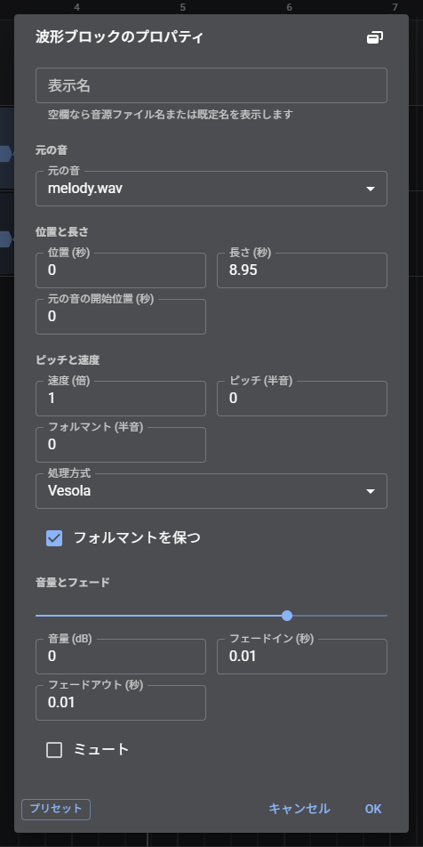

| 項目 | 内容 |
| --- | --- |
| 元の音 | 読み込み済みの音から選ぶか、ファイルから読み込む |
| 開始、長さ | 時間軸での位置と長さ（秒） |
| 元の音の開始位置 | 元の音の何秒から使うか |
| 速度 | 1/4 倍から 4 倍。ピッチは変えずに、長さが変わる。長さを変更せずに速度だけを変えたいときは、この欄を使う |
| 音量 | -60 dB から 24 dB |
| ピッチ | -256 から 256 半音（小数も使用できる） |
| フォルマント | -12 から 12 半音 |
| 処理方式 | ピッチを変える処理方式（WeVocalSynth と同じ）。波形ブロックごとに持つ |
| フォルマントを保持 | ピッチを変えるときに、声質を保つ |
| フェードイン、フェードアウト | 秒 |
| ミュート | その波形ブロックだけを鳴らさない |

プリセットを使うと、音の作り方（ピッチ、処理方式など）を保存して、呼び出せる。

### 編集バー

波形ブロックか範囲を選択すると、画面の下に編集のボタンが並ぶ。メニューを開かずに操作できる。入りきらないときは、横にスクロールする。

| 選択 | ボタン |
| --- | --- |
| 波形ブロック | 半音下げ、半音上げ、ピッチを戻す、切り取り、コピー、貼り付け、複製、分割、削除、ノーマライズ、プロパティ、確定 |
| MIDI ブロック | ピアノロール、音源、切り取り、コピー、貼り付け、複製、分割、削除、つなぐ、プロパティ |
| 範囲 | 範囲を再生、範囲で分割、範囲だけ残す、範囲を詰める、無音を挿入、繰り返し、選択を解除 |

波形ブロックと範囲の両方を選択している場合は、波形ブロックのボタンが表示される。

表示は、「設定」→「表示」→「編集バーの表示」で切り替える。

| 選択肢 | 動作 |
| --- | --- |
| 自動 | スマホとタブレットで表示する |
| 常に表示 | すべての端末で表示する |
| 表示しない | 表示しない |

### 右クリックのメニュー

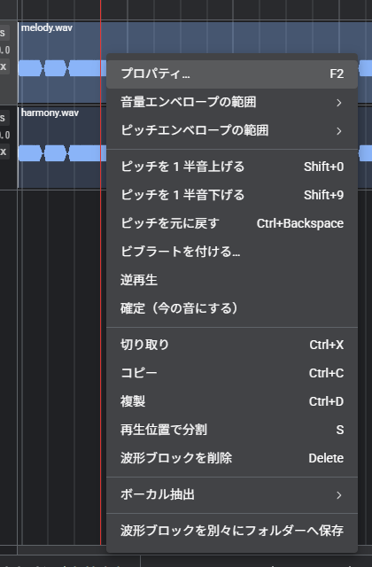

| 場所 | 項目 |
| --- | --- |
| 波形ブロック | プロパティ、エンベロープの範囲、ピッチ（上げ下げ、元に戻す）、ビブラート、逆再生、確定、切り取り、コピー、複製、分割、削除、ボーカル抽出、フォルダーへ保存。MIDI ブロックだけを選んでいるときは、プロパティ、ピアノロール、トラックの音源、切り取り、コピー、複製、分割、削除、つなぐ、書き出し |
| トラックの空いている所 | 押したトラックのミュート、ソロ、名前の変更、複製、削除、ここに貼り付け、ここに音声ファイルを読み込む、MIDI ブロックを追加、すべて選択、範囲の両端で分割、選択の解除、最終位置の指定、トラックの追加 |
| 時間目盛り | ここにマーカーを追加、最終位置に現在位置を指定する、最終位置の指定を解除する、テンポを解析、選択の解除（マーカーの上では、名前の変更、ここからのテンポ、削除も出る） |
| トラックの欄 | プロパティ、名前の変更、複製、フリーズ、フリーズ（FX を含める）、センド、サブトラックの操作、上下の移動、削除 |

## 範囲の操作

トラックの空いている所をドラッグして、範囲を選択する。スナップがオンの場合、範囲の端は最寄りのグリッドの線に合わせられる（Shift で外す）。

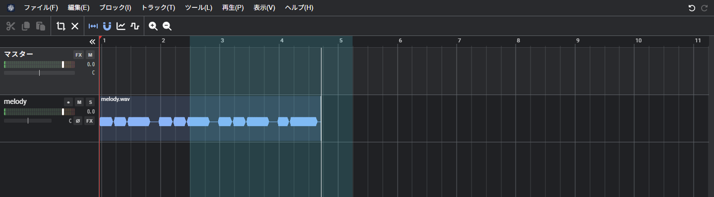

| 操作 | 動作 |
| --- | --- |
| 範囲を再生 | 範囲の中だけを再生する。リピートがオンなら、繰り返す |
| 範囲の両端で分割 | かかっている波形ブロックを、範囲の両端で分割する（Shift+S） |
| 範囲だけ残す | 範囲の外を削除する |
| 範囲を消して詰める | 範囲を削除し、後ろを前に詰める（Ctrl+Delete） |
| 範囲に無音を挿入 | 範囲の長さの無音を挿入し、後ろを送る |
| 範囲を繰り返す | 範囲の内容を、すぐ後ろに 1 回繰り返す |
| 範囲に合わせて拡大 | 範囲が画面に収まるように表示する（Ctrl+8） |

ステータスバーの範囲をクリックすると、数値で入力できる。

## ピッチと速度

- ピッチは元の音から作る。処理方式は WeVocalSynth と同じで、設定の「処理」は新しい波形ブロックの既定値になる
- ピッチのみを上げると、声が細く（子どもらしく）なる。「フォルマントを保持」をオンにすると、自然な声になる
- 24 半音を超える変更は、複数回に分けて処理される
- 速度は、ピッチを変えずに長さが変わる。プロパティでは長さは固定で、使用する元の音の範囲が変わる

| 操作 | キー |
| --- | --- |
| 1 半音上げる | Shift+0、テンキーの 9、Ctrl+↑ |
| 1 半音下げる | Shift+9、テンキーの 3、Ctrl+↓ |
| 10 セント上げる | Shift+テンキーの 9、Ctrl+Shift+↑ |
| 10 セント下げる | Shift+テンキーの 3、Ctrl+Shift+↓ |
| 元に戻す | Ctrl+Backspace、Ctrl+0 |

### ピッチをなめらかにつなぐ

「ブロック」→「ピッチをなめらかにつなぐ」は、選択した波形ブロック（2 つ以上）を、トラックごとに時間の順に見て、2 つ目からの頭に、前の波形ブロックの終わりのピッチから自分のピッチへ戻るピッチのエンベロープを足す（頭の 0.12 秒、波形ブロックの長さの半分まで）。音程の違う波形ブロックを続けて鳴らしたときの、ピッチの段差がなめらかになる。足したエンベロープは、ピッチのエンベロープの編集で直せる。 つなぎ直すと、前につないだ区間の点が新しい長さと形状に置き換えられる（もう一度同じ波形ブロックを選んで、長さと形状を変える）。

### 逆再生

「ブロック」→「逆再生」で、選択した波形ブロックの音を逆にする。元の音は書き換えず、使っている部分を逆にした新しい元の音を足して、波形ブロックをそちらに向ける。ピッチカーブ、ピッチと音量のエンベロープ、フェードも裏返る。もう一度かけると元に戻る。

### ビブラートを付ける

波形ブロックを右クリックして「ビブラートを付ける…」を選ぶと、選択した波形ブロック（範囲を選んでいれば、その中だけ）に、揺れの深さ、速さ、かかり始めの遅れを指定して、ピッチのエンベロープとして足せる。今あるエンベロープの上に重なり、足したあとは点を直せる。

### ピッチカーブ

解析の欄（[解析の欄](#解析の欄)）で、選択した波形ブロックのピッチを描き換えられる。

| 操作 | 動作 |
| --- | --- |
| ペン | なぞった高さにする。Alt+なぞるで消す |
| つかむ | ピッチの線を上下に移動する（範囲を選択していれば範囲、していなければ声の一続き）。Shift で半音刻み |
| カーブを消す | 描いたピッチカーブを削除する |

元のピッチ（F0）は薄い線で、変更後は水色の線で表示される。

「表示」→「ピッチのエンベロープ」（Shift+E）をオンにすると、時間軸の上で点を打って、ピッチ（半音）を変更できる。

## 音量とエンベロープ

- 音量は、波形ブロックの音量（プロパティ）、フェード、エンベロープ、トラックの音量とパン、マスターの順で掛かる
- 「ノーマライズ」は、選択した波形ブロックの最大の音量を -1 dB に合わせる

「表示」→「音量のエンベロープ」（E）をオンにすると、波形ブロックの上に線が表示される。

| 操作 | 動作 |
| --- | --- |
| 線をクリック | 点を追加する |
| 点をドラッグ | 点を移動する（前後の点は越えない） |
| 点をダブルクリック | 点を削除する |

点と点の間は、既定では dB で直線になる。点を右クリックして「形状」を選ぶと、その点から次の点までの形（直線、矩形、ゆっくり開始/終了、速く開始、速く終了、ベジェ）を変えられる。形は点が覚える。音量のエンベロープとピッチのエンベロープは、どちらか一方を表示する。

エンベロープの線や点の右クリックのメニューには、形状、点の削除、道具（選択、ペン）、エンベロープの初期化が出る。ピッチのエンベロープでは、ビブラートを付ける、ピッチをなめらかにつなぐも出る。選択の道具は線と点だけを触り、ペンの道具は波形ブロックのどこを押しても点を足す。波形ブロックを右クリックして「エンベロープの範囲」を選ぶと、そのブロックだけ範囲を変えられる。

## 確定

「ブロック」→「確定」は、選択した波形ブロックの現在の音（速度、ピッチ、音量、フェード、エンベロープを反映した音）を、新しい元の音にする。

- 位置、長さ、ミュートはそのままで、速度 1、ピッチ 0、音量 0 dB、フェードなしの波形ブロックになる
- 確定前の元の音はプロジェクトに残る。元に戻すで取り消せる
- トラックの音量、パン、FX は反映されない（トラックに残る）
- 確定した音は、ステレオ、48 kHz になる
- 処理の進み具合は、ステータスバーに表示される

## トラック

トラックの欄で操作する。

| ボタン | 内容 |
| --- | --- |
| ● | 録音待機。録音した音は、このトラックに配置される |
| M | ミュート |
| S | ソロ。ソロにしたトラックだけが鳴る |
| Ø | 位相の反転 |
| FX | FX の列（エフェクトを順に掛ける）を開く。何か掛かっているときは色が付く。マスターにもある |
| 音量 | レベルメーターを溝にしたつまみ。右に dB が表示される。ダブルクリックで 0 dB に戻る |
| パン | 真ん中から色が伸びる棒。右に C、L30、R30 のように表示される。ダブルクリックで中央に戻る |

- 名前はダブルクリックで変更できる。右クリックで、プロパティ、名前の変更、複製、フリーズ、センド、サブトラックの操作、上下の移動、削除を行う。「プロパティ」では、名前、音量、パン、ミュート、ソロ、位相の反転を、選んだ複数のトラックにまとめて設定できる（値が混在する欄は空欄で、+ や - を付けて入力すると各トラックの値から増減する）
- トラックの欄を、つかんで上下にドラッグすると、並び替えられる（ボタンとつまみ以外のどこでもよい。タッチでは、左端の ⠿ を使用する）
- 下端をドラッグして、トラックの高さを変更できる
- Ctrl+クリックで追加と解除、Shift+クリックで範囲の選択ができる。選択した複数のトラックのうち 1 つの音量やパンを動かすと、全部が同じ量だけ動く。ミュートとソロも全部に適用される
- トラックの欄を選択して Ctrl+C、Ctrl+V で、波形ブロックごとトラックを複製できる

### サブトラック

- トラックを親にして、子のトラックを持てる。子の音は親を通ってマスターへ送られる（親の音量、パン、FX、ミュートが子にも掛かる。子をソロにすると親も鳴る）
- 子は字下げして表示され、▸ でたたむ
- トラックの右クリックの「サブトラックを追加」「上のトラックの中に入れる」「外に出す」で操作する

### FX

トラックとマスターの「FX」から開く。左の列にエフェクトを並べ、上から順に掛ける。右に選んだエフェクトのつまみを表示する。

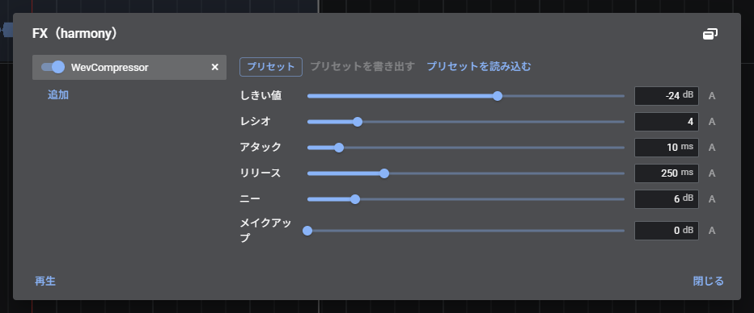

- 「追加」で、エフェクトを列の最後に足す。各行のスイッチでオンとオフ（オフは素通し）、↑ ↓ で並び替え、× で削除する
- つまみはダブルクリックで既定値に戻る。プリセットは、今の値を名前を付けて保存して呼び出せる
- 再生中も、鳴らしたまま変更できる。書き出しにも同じように掛かる
- 入っていないエフェクトを使ったプロジェクトを開くと、そのエフェクトは素通しになる（値は残る）
- 以前のプロジェクトのトラックの EQ は、FX の列の先頭の「グラフィック EQ」に引き継がれる

#### プラグインの追加

設定の「プラグイン」で、プラグインのマニフェストの URL を入れて「追加」を押すと、FX の「追加」に出てくる。追加するときに、作者、版、必要な権限が表示される。

- 追加したプラグインは、この端末に保存される。ネットがなくても使える。「更新」で追加した URL から新しい版を取り直し、「×」で削除する
- 追加機能の保存先のフォルダーを選んでいれば、プラグインもそのフォルダーに保存され、ほかの端末やブラウザと共有できる
- 重くて音が途切れるプラグインは、自動で素通しになる（FX のダイアログに表示される。オフにしてからオンにすると、もう一度試す）
- 入っていないプラグインを使ったプロジェクトを開くと、追加を勧める通知が出る
- 独自の画面を持つプラグインは、つまみの代わりにその画面が出る
- 設定の「処理」の「重いプラグインを先に計算して鳴らす（試験的）」をオンにすると、重いプラグインを持つトラックの音を、再生位置より先に別のスレッドで作る。音が途切れにくくなるが、再生を始めるまで少し待つ。再生中にそのトラックを編集すると、次に再生するまで通常の処理に戻る。子のトラックを持つトラック、サイドチェーンを使うプラグインは対象外。先に計算した音は再生を止めたあとも保持し、同じ所をもう一度再生するときは計算し直さない（保持する量は「先に計算した音の保持量」。0 で保持しない）
- 「途切れずに先を計算する」（試験的）をオンにすると、外から追加したプラグイン（WeVocal の形式）だけを使うトラックは、かたまりに分けず、同じプラグインを再生位置の少し先で動かし続ける。再生中に編集しても先に計算したまま反映される。WAM、VST、組み込みの FX、音源、子のトラックを持つトラックは、今までの方式で計算する
- プラグインは、このアプリと同じ場所で動き、アプリから隔離されない。信頼できる作者のものだけを追加する
- 再生中の FX のダイアログに、音を作る処理の負荷が表示される（対応しているブラウザのみ）
- プラグインの作り方は wevocal-lib の plugin-sdk/README.md

#### VST（試験的）

Windows の VST2 のプラグイン（DLL）を、エミュレーターで動かして FX として使える。試験的な機能で、動かないプラグインもある。

- 使うには、設定の「開発者向け」で「VST（Windows のプラグイン）を読み込めるようにする（試験的）」をオンにする。設定の「プラグイン」に「VST（DLL）を選ぶ」が出る。DLL のファイルを選ぶか、DLL の URL を入れて「追加」を押す
- DLL は、ブラウザの中のエミュレーター（wasm）で動く。WeVocal Studioの外には出ない。DLL そのものはこの端末に保存され、プロジェクトにはプラグインの名前とつまみの値だけが入る
- つまみの数と名前は DLL から読み取られ、0 から 1 の値で動かす。DLL が自分の画面（つまみの絵）を持つときは、FX のダイアログにその画面が表示され、マウスで操作できる（32 ビットの DLL のみ）。画面の上の「プラグインの画面」と「標準の画面」で、標準のつまみの画面に切り替えられる。画面を持たない、または対応していないものは、標準の画面だけになる
- エミュレーターで動かすため、処理が重い。軽いプラグインは再生中もそのまま掛かり、処理が間に合わないほど重いと、自動で素通しになる。トラックの「フリーズ（FX を含める）」で、FX まで掛けた音に確定することもできる。設定の「処理」の「重いプラグインを先に計算して鳴らす（試験的）」をオンにすると、再生位置より先を先に計算して鳴らす（計算が間に合わない所は素通しになる）
- 動かないプラグインの例: 64 ビットの AVX 命令やスレッドを使うもの、画面に高度な描画（OpenGL など）を使うもの、認証（コピーガード）があるもの。読み込めなかったときは、理由が表示される
- 出力に NaN や無限大が出たプラグインは、そのブロックを無音にして、以後は素通しにする
- 利用規約で解析や改変を禁じているプラグインは使わない。自分で作ったもの、使用を許可されているものだけを使用する

#### エフェクトの種類

標準のエフェクトの名前は、どの言語でも「Wev」＋英語（WevReverb など）。追加の一覧では、名前の下に説明が出て、名前や説明の言葉で探せる。FX の列の名前にカーソルを合わせても、説明が出る。

| 名前 | つまみ |
| --- | --- |
| WevEQ（グラフィック EQ） | 帯の数（10 帯、31 帯）、上限（±12 dB、±24 dB）。グラフをなぞって描く |
| WevGate（ノイズゲート） | しきい値、絞る量、アタック、ホールド、リリース。小さい音（息やノイズ）を絞る |
| WevCompressor（コンプレッサー） | しきい値、レシオ、アタック、リリース、ニー、メイクアップ |
| WevSidechain（サイドチェーン・コンプレッサー） | しきい値、レシオ、アタック、リリース、メイクアップ。ほかのトラックの音の大きさで、このトラックを下げる（Studio のみ、音を取るトラックを選ぶ） |
| WevDeEsser（ディエッサー） | 周波数、しきい値、レシオ、リリース。サ行の刺さる高域だけを抑える |
| WevFilter（フィルター） | 種類（ハイパス、ローパス、バンドパス、ノッチ）、周波数、Q、傾き（12、24 dB/oct） |
| WevPitch | ピッチ（半音）、フォルマント（半音）、フォルマントを保持、処理方式（Phasera、Vedict）。ピッチとフォルマント（声の響き）を、再生中にそのまま変える簡易版。遅れは Phasera で約 16 ミリ秒、Vedict で約 43 ミリ秒（Vedict は単音の声向けで、声色が自然に残る）。遅れは約 16 ミリ秒 |
| WevDistortion（ディストーション） | ドライブ、種類（ソフト、ハード、フォールド）、音色、出力、ミックス |
| WevDelay（ディレイ） | テンポに合わせる（1/4、1/8、付点 1/8、1/16）、間隔、フィードバック、音色、ミックス |
| WevReverb（リバーブ） | 種類（部屋、ホール、プレート）、大きさ、高域の減衰、ミックス、プリディレイ |
| WevChorus（コーラス） | 速さ、深さ、遅れ、ミックス |
| WevEnsemble（アンサンブル） | 声の数（2 から 8）、速さ、深さ、遅れ、広がり、ミックス。声を重ねて左右に広げる |
| WevLimiter（リミッター） | 天井、リリース。マスターでの使用に向く |

- つまみの右の「A」で、そのつまみのオートメーションを時間軸に出す（Studio のみ。下の「オートメーション」）
- 書き出し専用のプラグイン（外から追加するもの）は、再生中は素通しで、書き出しのときだけ掛かる

#### グラフィック EQ

10 帯と 31 帯、±12 dB と ±24 dB を切り替えられる。

### フリーズ

ピッチや速度を変えた波形ブロックが多いと、再生のたびに音を作る処理が重くなる。フリーズは、トラックの音を一度書き出して、普通の音声として鳴らす機能。処理が軽くなり、再生が途切れにくくなる。

- トラックの右クリックの「フリーズ」で書き出す。進み具合はステータスバーに表示される
- 書き出すのは、そのトラックの波形ブロックと MIDI ブロックの音（速度、ピッチ、フォルマント、音量、フェード、エンベロープを反映した音）と、サブトラックの音（それぞれの音量、パン、FX まで）。トラック自身の音量、パン、FX、位相の反転は書き出さないので、フリーズ中も変更できる
- サブトラックを持つトラックをフリーズすると、サブトラックもまとめてフリーズ中になる（鳴らさず、波形ブロックを変更できない）。サブトラックから、ほかのトラックへのセンドは書き出されない
- 「フリーズ（FX を含める）」は、トラックの FX の列まで掛けた音を書き出す。重い FX（VST のリバーブなど）を確定して、再生を軽くできる。FX の余韻の分も書き出す。フリーズ中は FX を変更できない（音量、パン、位相の反転は変更できる）。サイドチェーンで、ほかのトラックの音を聞く FX は、その音なしで書き出される
- フリーズ中は、トラック名の横に ❄ が表示され、波形ブロックは少し薄く表示される。波形ブロックの移動、削除、ピッチの変更などはできない
- 「フリーズを解除」で元に戻る。波形ブロックと設定は残っているので、そのまま編集を続けられる
- サブトラックは、それぞれのトラックでフリーズする（親をフリーズしても、子の音は書き出されない）
- 書き出した音は、プロジェクトに保存される（解除すると消える）

「確定」との違い: 確定は波形ブロックを書き出した音に置き換え、元の設定は残らない。フリーズは元の波形ブロックと設定を残し、いつでも元に戻せる

### センド

トラックの右クリックの「センド…」で、そのトラックの音（フェーダーのあと）を、ほかのトラックの入口へ送る。リバーブなどを入れたトラックに複数のトラックから送ると、共有できる。送る量が下限なら送らない。音が輪になる送り先は選べない。

### オートメーション

エフェクトのつまみを、曲の時間に沿って変える。

1. トラックかマスターの「FX」を開き、変えたいつまみの右の「A」を押す。つまみの折れ線が、トラックの行（マスターは上の帯）に出て、「表示」の「オートメーションを編集」がオンになる
2. 折れ線の上で、押すと点を足し、ドラッグで動かし、点のダブルクリックで消す（グリッドに合わせる。Shift で外す）。点の間は直線でつなぐ。点を右クリックして「形状」を選ぶと、その点から次の点までの形（直線、矩形、ゆっくり開始/終了、速く開始、速く終了、ベジェ）を変えられる。形は点が覚えるので、点を動かしても保たれる。選択肢のつまみは次の点まで保つ
3. 点がないつまみは、FX のダイアログの値のまま。再生と書き出しのどちらにも反映される

「A」をもう一度押すと、折れ線を隠す（点は残る）。

### マスタートラック

一番上の行。音量、パン、ミュートを持つ。縦にスクロールしても、目盛りとマスターの行は上に固定される。

## 再生

| 操作 | 動作 |
| --- | --- |
| Space | 再生と停止 |
| Ctrl+Space | 一時停止（その場に残り、続きから再生する） |
| Home、End | 先頭へ、末尾へ |
| R | リピート |
| ← → | 編集カーソルを 1 拍ずつ移動する |
| F | 再生位置に追従（オフにすると、再生中も表示が動かない） |

- 停止すると再生カーソルは消え、次の再生は編集カーソルの位置から始まる。停止ボタンは、再生を始めた位置に戻る
- 曲の終わりで、再生は止まる。曲の終わりは、最後の波形ブロックの終わりに、掛けている FX の余韻（リバーブやディレイが鳴り続ける長さ）を足した位置になる。時間軸の何もない所かルーラーの右クリックの「最終位置に現在位置を指定する」で決めると、書き出しの長さもそこまでになる。「最終位置の指定を解除する」で自動に戻る
- 範囲を選択している場合は、範囲の中だけを再生し、リピートで繰り返す
- 再生中に変更した波形ブロックだけが、差し替えられる。音量、パン、ミュート、ソロ、FX は、鳴らしたまま反映される
- 音声の出力先と、鳴らす音の上限（リミッター）は、設定で変更する

## テンポと拍の線

- 再生のバー、またはステータスバーで BPM、拍子、グリッドの細かさを変更する
- BPM は、候補、タップ、×2、÷2 で変更できる。「再生」→「テンポを解析」は、選択した波形ブロックから BPM と 1 拍目を求める
- グリッドの細かさは、1/1 から 1/256 音符。3 や 6 を入力すると、3 連符になる。拍より細かい線は、薄く表示される
- 「表示」→「拍と小節で表示」で、目盛りを秒に切り替えられる
- テンポが途中で変わる曲は、マーカーで設定する（[マーカー](#マーカー)）

### スナップ

ドラッグ、編集カーソル、範囲の端が、グリッドの線、ほかの波形ブロックの端、編集カーソルに吸い付く。Shift を押している間は外れる。Alt+S、または「表示」→「スナップ」で切り替える。

## マーカー

| 操作 | 動作 |
| --- | --- |
| M | 編集カーソルの位置にマーカーを追加する |
| ] 、 [ | 次、前のマーカーへ移動する |
| マーカーをダブルクリック | 名前の変更、テンポ、削除 |

マーカーに「ここからテンポを変える」を設定すると、そのマーカーから拍を数え直す。グリッド、小節の番号、スナップ、← → の移動が、その区間のテンポに従う。

## 録音

1. 録音するトラックの ● をクリックして、録音待機にする（なければ、選択中のトラックか、空いているトラック、新しいトラックの順に使用する）
2. 再生のバーの ●、または Ctrl+R で録音を開始する。編集カーソルの位置から、ほかのトラックを鳴らしながら録音する
3. もう一度クリックして停止すると、録音した音が波形ブロックとして配置される。録音中は、録音した分だけ波形ブロックが伸びて表示される

入力元は「設定」→「全般」で選択する。ブラウザによる音の加工（エコー除去、ノイズ抑制、自動音量調整）は、既定ではオフである。

## MIDI ブロックと音源

音符を MIDI のまま持つブロックと、それを鳴らす音源。メニューバーの「ブロック」→「MIDI」から操作する。

- 「ブロック」→「MIDI」→「MIDI ブロックを追加」で、選択中のトラックの編集カーソルの位置に、2 小節の空の MIDI ブロックを置く（何もない所の右クリックからも置ける）。音源のないトラックには、標準のシンセが付く
- 「MIDI」→「MIDI ファイルを読み込む…」で、読み込むトラック、チャンネルごとにトラックを分けるか、テンポ（プロジェクトのテンポに乗せる、または MIDI のテンポと拍子をプロジェクトに入れる）、置く位置（編集カーソル、先頭）を選ぶと、新しいトラックと MIDI ブロックを作る。音の強さ（ベロシティ）も読み込む
- 「MIDI」→「MIDI ファイルとして書き出す…」で、選んだ MIDI ブロック（選んでいなければ全部）を、トラックごとの標準 MIDI ファイル（形式 1）にする。テンポ、拍子、マーカーのテンポの変化も書く。ミュートしたブロックと音符は入れない
- MIDI ブロックの音符は拍で持つので、テンポを変えても音符は拍の位置に付いてくる（MIDI ブロックの位置と長さも、テンポに合わせて直る）
- MIDI ブロックは、波形ブロックと同じように、選択、コピー、切り取り、貼り付け、複製（Ctrl+D）、分割（S。またぐ音符は両方に残る）、削除ができる。ドラッグで動かし（縦に動かすとほかのトラックへも移る）、右端のドラッグで長さを変え、左端のドラッグで左端を詰める（左端より前になる音符は切られる。ドラッグの途中なら戻せる）。Alt を押しながら右端をドラッグすると、今の中身を 1 回分のループにして長さを変える（中身が繰り返されて伸びる。ループの境目に縦線が出る）。「プロパティ」で位置、長さ、ループの長さ（拍。0 でなし。ループより後ろの音符は鳴らない）、ミュートを数値で変えられる。複数の MIDI ブロックを選んで「MIDI」→「MIDI ブロックを 1 つにつなぐ」を選ぶと、同じトラックのものが 1 つになる（ループは展開される）。ダブルクリックか「ピアノロールを開く」で、音符を編集する
- ピアノロール: 上のメニューバーに「編集」、「変換」、「表示」があり、その下のツールバーに、道具（選択 E、ペン P、消しゴム D、分割 C、ミュート T）、スナップ、グリッド、編集（切り取り、コピー、貼り付け、複製、削除）、ズーム、再生のボタンがある。「変換」のメニュー（移調、クオンタイズ、クオンタイズの設定（始まりと長さ、強さ、スイング）、レガート、接着（Ctrl+G）、ヒューマナイズ（始まりと強さをランダムにずらす））と、「表示」のメニュー（音の確認のオンとオフ、スケールの強調（メジャー、マイナー、ペンタトニック。スケールの外の行が暗くなる）と主音）がある。ツールバーの下の欄では、選んだ音符の開始、長さ、高さ、強さを数値で直せる（複数選んでいれば、入れた値が全部に反映される）。左の鍵盤を押すと、その高さの音が鳴る。操作の説明は右上の ? に表示される。空いている所を押すと音符が足され（そのままドラッグで長さ）、音符のドラッグで時間と音の高さを動かし、右端のドラッグで長さを変える。ダブルクリックか Delete で音符を消す。Shift を押しながらクリックで選択の足し引き、Shift を押しながら空いている所をドラッグで枠で選択、Ctrl+A で全部を選ぶ。選んだ音符は一緒に動き、長さも一緒に変わる。下の帯は音の強さ（ベロシティ）で、棒をドラッグして変える（選んだ音符は同じ値になる）。音符を押したり動かしたりすると、その高さの音を音源で鳴らす。矢印で選んだ音符を動かし（Shift+上下でオクターブ、Shift+左右で長さ）、Ctrl+C、X、V、D でコピー、切り取り、貼り付け（選んだ音符の終わりの次へ）、複製、Q かボタンでクオンタイズ（始まりと長さをグリッドに寄せる）、ボタンでレガート（次の同じ高さの音符の頭まで伸ばす）ができる。ホイールで表示する音の高さをずらし、Ctrl+ホイールで横に拡大と縮小、Shift+ホイールで横にスクロール、Alt+ホイールで行の高さを変える。グリッドは時間軸と同じ細かさ（1/1 から 1/256、3 連符）で、Alt を押している間はグリッドに合わせない。再生中は再生位置の線が表示される。ウィンドウの大きさに合わせて広がる。音符の上に、小節と拍の目盛りがあり、ブロックの終わりに旗が立つ（旗をドラッグすると、ブロックの範囲を広げたり狭めたりできる。ブロックの右端のドラッグでも同じ）。再生ボタンは、ピアノロールのブロックの範囲だけを再生し（時間軸に範囲として選ばれる）、その横のボタンで範囲を繰り返す。「表示」の「鍵盤の折りたたみ」で、音符のある高さの行だけを見せる（行は高くなる。新しい高さの音符を足すときは、折りたたみを戻す）。「表示」の「画面の鍵盤」で、下に 2 オクターブの鍵盤が出る（押している間、その高さの音が鳴る。◀ ▶ で 1 オクターブずつずらす。MIDI キーボードがない端末や、スマホで使う。指で操作する端末では最初から出る）。「ステップ入力」をオンにすると、MIDI キーボードか画面の鍵盤を弾くたびに、点線の位置に音符が置かれ、鍵盤を全部離すと位置が音符の長さだけ進む（和音は同時に押した分が同じ位置に入る。「休符」で位置だけ進める）。情報行の右の「レーン」で、下の帯を、強さのほかに、ピッチベンド、モジュレーション（CC1）、音量（CC7）、パン（CC10）、エクスプレッション（CC11）、サステイン（CC64）に切り替えられる。曲線のレーンでは、空いている所を押すと点が足され、点のドラッグで動かし（前後の点は越えない）、右クリックで点を消す。点は直線でつながり、最後の点の値が続く。標準のシンセとサンプラーは、ピッチベンド（±2 半音）とサステインを受ける。MIDI ファイルの CC とピッチベンドも、読み込みと書き出しの対象になる。ダイアログの題名の右のボタンで、画面の下の欄（ドック）に置ける（置いたかどうかは覚える。欄の上の端をドラッグして高さを変え、タブの「ダイアログにする」で戻す。パソコンの画面のみ）。欄に置いている間は、ピアノロールのメニュー（編集、変換、表示。アイコンを押すと開く）とボタンが、メインのツールバーの右に表示される 上の目盛りを押すと編集位置、なぞると範囲選択になる（メインの時間軸と同じもので、グリッドに合わせ、Shift で外す。Esc で範囲を解除）。再生は、編集位置か範囲がそのブロックの中にあればそこから、なければブロック全体を鳴らす
- 「トラックの音源…」で、トラックの音源を選ぶ。標準は、シンセ（波形、エンベロープ、カットオフ、デチューン、音量）とサンプラー（プロジェクトの元の音を音色にして、音符の高さに合わせて鳴らす。つまみの「フォルマントを保持」をオンにすると、音符の高さごとに、波形ブロックのピッチと同じ処理で音を作り、声の音色と長さを変えずに高さだけを合わせる。そのときの処理方式は、音源の画面の「処理方式」で選ぶ（既定は Legacy Wevia）。作っている間は、元の音の速度を変えて鳴らす。処理が重いので、既定はオフ）。設定の「プラグイン」で追加した音源も選べる。音量、FX、パンはトラックのものを使う
- 音源は、波形ブロックの音と同じトラックに流れるので、波形ブロックと MIDI ブロックを同じトラックに置ける

### MIDI キーボード

設定の「全般」の「MIDI キーボードを使う」をオンにすると（Chrome、Edge）、つないだキーボードを弾いた音が、音源のあるトラック（録音待機のトラック、なければ選択中のトラック）で鳴る。音源のあるトラックを録音待機にして録音すると、音ではなく弾いた音符が MIDI ブロックとして録られる。設定の「全般」で、使う機器（つないだすべて、または 1 つ）、受けるチャンネル（0 ですべて）、サステインペダルを使うか、録音の遅れの補正（ms）、録り方（新しいブロックに録る、または録り始めの位置にあるブロックに重ねる）を選べる。

## プラグインによる処理と解析

「ツール」→「プラグインで処理…」「プラグインで解析…」で、選択した波形ブロックの音（ピッチ、速度、音量、フェード、エンベロープを反映した音）に対して、処理を実行する、または解析する。

- 処理は、加工した音を新しい元の音にして、波形ブロックを置き換える（「確定」と同じ。元に戻せる）。標準は、ノーマライズ（目標のピークを指定）、逆再生、直流成分の除去、モノラルにする
- 解析は、結果を一覧で表示する（波形ブロックは変えない）。標準は、ラウドネスとピーク（長さ、ピーク、RMS、統合ラウドネス、クレストファクター、直流成分、クリップしたサンプル）と、スペクトルの特徴（一番強い周波数、重心、85% の周波数、低域、中域、高域の割合）
- 設定の「プラグイン」で追加した処理と解析も、同じ一覧に出る

## ボーカル抽出

選択した波形ブロックの音を分け、新しいトラックに並べる。使用するには追加機能（モデル）の導入が必要で、初回に導入のダイアログが表示される。

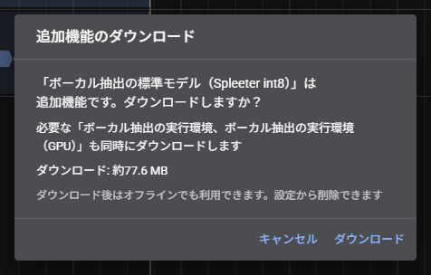

| 項目 | 内容 |
| --- | --- |
| ボーカルと伴奏に分ける | 2 つのトラックに分ける |
| 主旋律、ハモリ、伴奏に分ける | 3 つのトラックに分ける |
| 楽器ごとに分ける | 楽器ごとのトラックに分ける。設定でボーカルを主旋律とハモリにも分けられる |

- 分けた音は、元のトラックのすぐ下（同じ親の下）に配置される。位置、速度、ピッチなどは、元の波形ブロックの値が引き継がれる
- 使用するモデルと、GPU の使用は、「設定」→「ボーカル抽出」で選択する。GPU で処理できない場合は、CPU で続行するか確認される
- 進み具合は、ステータスバーに表示される

### 和音の分離（試験的）

「設定」→「開発者向け」の「「和音を分離」を表示する」をオンにすると、同じメニューに「和音を高い方と低い方に分離」「和音を大きい方と小さい方に分離」が表示される。追加機能は不要。

- 選択した波形ブロックの音を 2 つの声に分け、新しい 2 つのトラックに配置する。2 つを足すと元の音になる
- 2 人のハモリなど、単純な和音向け。伴奏が入っている場合は、先にボーカル抽出で伴奏を除くと精度が上がる

## 音声の作成

「ツール」→「音声を作成…」で、音を 0 から作成する。作成した音は、波形ブロックとして配置される。

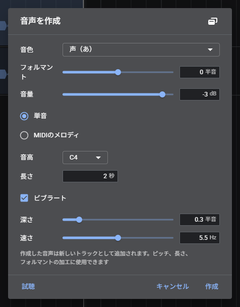

## MIDI の音符に並べる

「ツール」→「MIDI の音符に並べる…」で、選択した波形ブロックを、MIDI ファイルの音符に合わせて並べる。波形ブロックを複製し、音符ごとにピッチと長さを決める方式で、音そのものは処理しない。新しいトラックに配置される。

## 一音ずつ切り出す

「ツール」→「一音ずつ切り出す…」で、選択した波形ブロックを、一音（あ、い、う…）ずつに分け、波形ブロックにして新しいトラックに並べる。追加機能「歌詞の文字化」と「解析」が必要である。

## 解析の欄

「表示」→「解析の欄」で、時間軸の下の欄（ドック）に表示する。選択した波形ブロックの音を、時間軸と位置をそろえて描く。

- タブの右クリックで、左、右、上の欄に移せる。「ダイアログにする」でダイアログにもできる（下の欄にあるときだけ、時間軸と位置がそろう）
- タブの × で閉じる（もう一度「表示」→「解析の欄」で出す）
- スペクトログラムと、ピッチ（F0）の線を表示する
- マウスの位置の周波数と音名が表示される
- ピッチカーブの編集に使用する（[ピッチカーブ](#ピッチカーブ)）

### 配置

「表示」→「配置」→「今の配置を保存」で、欄の置き場所、分割とタブの組、欄の大きさに名前を付けて保存する。「配置」の下の名前を選ぶと、その配置に戻る。

- 解析の欄は、保存したときに開いていれば開き、閉じていれば閉じる
- ほかのパネル（FX、ピアノロールなど）は、配置を戻したあと、次に開いたときに戻した場所に表示される
- 「配置を削除」で消す

## 操作履歴

「編集」→「操作履歴…」で、操作の一覧が開く。クリックした時点まで戻る、進む。

- 元に戻す（Ctrl+Z）、やり直す（Ctrl+Shift+Z、Ctrl+Y）
- ドラッグ、スライダーの連続した操作は、1 回分にまとめられる
- 元に戻せる回数は、設定で変更する

## プロジェクトのタブ
複数のプロジェクトを 1 つの窓で開ける。2 つ以上開いている間、メニューの下にタブが表示される。
- 「新しいプロジェクト」（Ctrl+N）と、ファイルを開くときは、使っているプロジェクトは残したまま、新しいタブに開く。何も置いていないプロジェクトのときは、そのタブを置き換える
- タブを押すと切り替わる。元に戻す、やり直す、選択、編集位置、時間軸の表示は、タブごとに持つ
- タブの × か中ボタンで閉じる。保存していない変更があるタブは、名前の後ろに * が付き、閉じるときに確かめる。最後の 1 つを閉じると、新しいプロジェクトになる
- 自動保存と、起動時の復元の対象は、開いているタブすべて（タブの並びと、表示していたタブも戻る）
- 波形ブロックとトラックは、ほかのタブにコピーして貼り付けられる（元の音も一緒に運ばれる）

## 画面の端の欄（ドック）
ピアノロール、ブロックのプロパティ、トラックのプロパティ、トラックの音源、センド、MIDI ブロックのプロパティ、FX、EQ、音声の作成、サンプラーのダイアログは、ダイアログのかわりに、画面の端の欄に置ける（パソコンとタブレット。スマホはダイアログのまま）。

- ダイアログの題名の横の「欄に置く」を押すと、画面の下の欄に置く。置く端は、ダイアログごとに覚える
- タブを画面の端へドラッグして近づけると、置ける端に印が出る。そこで離すと、その端の欄に移る
- タブを本体の窓の外へドラッグして離すと、その位置に別の窓（ポップアップ）として開く（ブラウザが別の窓に対応しているとき。閉じたら、元の出し方に戻る）
- 欄の中のタブを右クリックすると、「下に置く」、「左に置く」、「右に置く」、「上に置く」、「ダイアログにする」を選べる
- 同じ端に複数置くと、タブで切り替える。タブをドラッグして欄の端に落とすと、分割して並べられる
- 欄の内側の端をドラッグして、欄の大きさを変える（ダブルクリックで元の大きさ）。大きさは端ごとに覚える
- 欄の中の並び（分割、タブの組、それぞれの大きさ）も端ごとに覚え、次に開いたときに戻す
- タブの × でダイアログを閉じ、タブの「ダイアログにする」で欄から外す
- 別の窓（ポップアップ）に出したダイアログは、本体の窓の端に寄せて離すと、その端の欄に置く（動かしているあいだは、置ける端に印が出る）。設定の「表示」の「別の窓を端に寄せて離したら、欄に置く」で切り替える
- ピアノロールのメニューバーとボタンは、欄に置くと、メインのツールバーに出る

## 書き出し

「ファイル」→「書き出す…」（Ctrl+Alt+R）で、全トラックを混ぜた音を保存する。

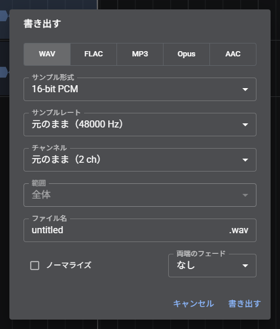

| 項目 | 内容 |
| --- | --- |
| 形式 | WAV、FLAC、MP3、AAC、Opus |
| サンプル形式、ビットレート | 形式ごとの音質 |
| サンプルレート | 書き出す音のサンプルレート。「元のまま」は 48 kHz |
| チャンネル | 元のまま（ステレオ）、またはモノラル |
| 範囲 | 全体、または選択した範囲 |
| ノーマライズ | 最大の音量を揃える |
| 両端のフェード | 先頭と末尾に、短いフェード（なし、5、10、20、50 ms）を付ける |
| 保存先フォルダー、ファイル名 | 保存するフォルダー（Chrome、Edge。覚えておく）とファイル名を決めてから書き出す |

動画ファイルへの書き出し（追加機能「変換」）も、「ファイル」から行える。

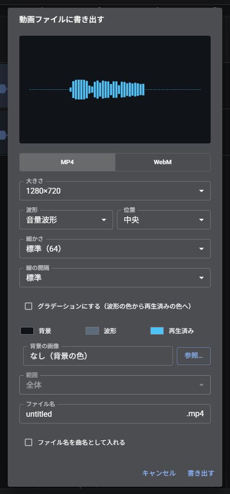

「ファイル」の「WeVocalSynth のプロジェクトに書き出す」で、波形ブロックがあるトラックを 1 本ずつ描画した .wvsp を保存できる。トラックを選んでいれば、そのトラックと子のトラックだけを書き出す。WeVocalSynth で続けて加工できる

## 設定

「ファイル」→「設定…」で開く。パソコンでは別のウィンドウで開く。

左の一覧から分類を選ぶ。上の検索欄で、項目の名前から探せる。「編集」「キーとマウス」「ファイル」は「全般」の下、「ボーカル抽出」は「処理」の下に並ぶ。

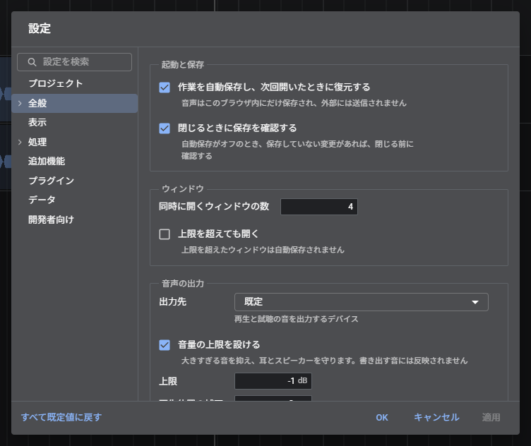

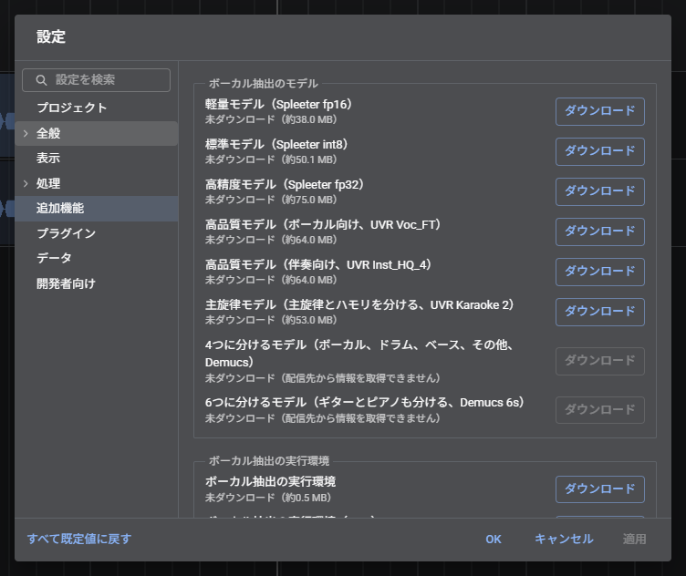

| 分類 | 内容 |
| --- | --- |
| プロジェクト | プロジェクトの名前、BPM、拍子、1 拍目の位置 |
| 全般 | 自動保存と復元、閉じる前の確認、ウィンドウの数、音声の出力先と上限（リミッター）、再生位置の表示の補正、録音の入力元とブラウザの音声処理、MIDI キーボード（機器、チャンネル、サステイン、録音の遅れ、録り方）、アップデート |
| 編集 | 元に戻せる回数、スライダーのダブルクリックでの初期化、新しい波形ブロックのフェード、貼り付けと無音の挿入のあとの再生位置、グリッド（拍か時間） |
| キーとマウス | Ctrl+S の動作（保存か書き出し）、ホイールでの拡大縮小の操作、キーの割り当て（操作ごとに複数のキーを割り当てられる） |
| ファイル | 開く、保存するフォルダーの記憶、最初に開くフォルダー、最近使用したファイル（Chrome、Edge のみ表示される） |
| 表示 | テーマ、画面の拡大率、編集バーの表示、レベルメーター、ミニマップの再生位置、別の窓を端に寄せたときの動作、音量とピッチのエンベロープの範囲、言語 |
| 処理 | 新しい波形ブロックの処理方式とフォルマントの既定値、従来の処理方式の表示、重いプラグインを先に計算して鳴らす設定、テンポの自動解析と新しいプロジェクトの BPM、解析の欄の音の範囲、「平らにする」の強さ |
| ボーカル抽出 | モデル、GPU、高域の保持、一音ずつ切り出す前のボーカル抽出、CPU のスレッド数とメモリの上限、楽器ごとの分離のモデル、ボーカルの主旋律とハモリへの分離 |
| 追加機能 | ボーカル抽出のモデルと実行環境、解析、歌詞の文字化、変換の導入と削除 |
| プラグイン | プラグインの追加（マニフェストの URL。VST は開発者向けで有効にしたとき）と更新、削除 |
| データ | 保存されているデータの確認と削除 |
| 開発者向け | デバッグ表示、開発版の更新の受け取り、「和音を分離」の表示、VST と開発者向けのプラグインの表示、停止中の音声処理の一時停止、iPhone と iPad の消音スイッチでの再生、追加機能の保存先のフォルダー、ファイルの選択方法、ダイアログの表示方法 |

## キーボード操作

「ヘルプ」→「ショートカット一覧」で、現在の割り当てを一覧できる。割り当ては、「設定」→「キーとマウス」で変更する。

| 操作 | キー |
| --- | --- |
| 再生と停止 | Space |
| 一時停止 | Ctrl+Space |
| 録音 | Ctrl+R |
| リピート | R |
| 先頭へ、末尾へ | Home、End |
| 編集カーソルを 1 拍移動 | ← → |
| 波形ブロックを 1 拍移動 | テンキーの 4、6 |
| 拡大、縮小 | テンキーの +、-（= と - も使用できる） |
| 全体を表示 | Ctrl+9 |
| 範囲に合わせて拡大 | Ctrl+8 |
| 切り取り、コピー、貼り付け | Ctrl+X、Ctrl+C、Ctrl+V |
| 複製 | Ctrl+D |
| トラックを追加 | Ctrl+T |
| すべて選択 | Ctrl+A |
| 分割 | S |
| 範囲の両端で分割 | Shift+S |
| 削除 | Delete |
| プロパティ | F2 |
| 選択の解除 | Esc |
| 元に戻す、やり直す | Ctrl+Z、Ctrl+Shift+Z（Ctrl+Y） |
| 音量のエンベロープ | E |
| ピッチのエンベロープ | Shift+E |
| スナップ | Alt+S |
| 再生位置に追従 | F |
| マーカーを追加 | M |
| 次、前のマーカー | ]、[ |
| 新しいプロジェクト | Ctrl+N |
| 新しいウィンドウ | Ctrl+Shift+N |
| 開く | Ctrl+O |
| 保存 | Ctrl+S |
| 名前を付けて保存 | Ctrl+Shift+S |
| 音声ファイルを読み込む | Insert |
| 書き出す | Ctrl+Alt+R |

ピッチのキーは、[ピッチと速度](#ピッチと速度)を参照する。

## 困ったとき

| 症状 | 対処 |
| --- | --- |
| 音が出ない（iPhone、iPad） | 再生をもう一度行う。マナーモードでも鳴るように作られているが、音量や出力先も確認する |
| ピッチや速度を変更した直後は、音が元のままである | 変更した音を作成している途中である。ステータスバーのゲージが終わるまで待つ。作成が終わると、自動で差し替わる |
| 再生位置は進むのに、音が出ない時間がある | 再生位置を変更した直後は、その位置の音を作成している。作成が終わるまで待つ |
| 繰り返し複製すると、少しずつずれる | 元の音が短い場合、波形ブロックの長さがグリッドと合っていない可能性がある。スナップをオンにして、端をグリッドの線に合わせてから複製する |
| ボーカル抽出が動かない | 追加機能（モデル）を導入する。GPU で失敗する場合は、「設定」→「ボーカル抽出」で GPU をオフにする |
| 録音できない | ブラウザのマイクの許可を確認する。入力元は、「設定」→「全般」で選択する |
| 最新の状態にならない | 「ヘルプ」→「更新を確認」を実行する |
