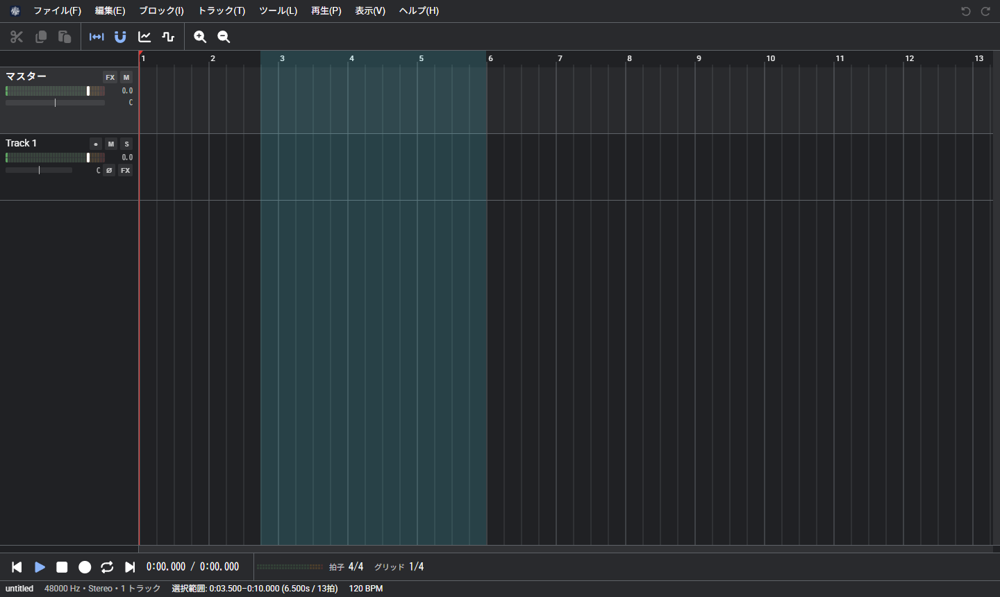

# WeVocal Studio
WeVocal Studio は、Web ブラウザ上で、トラックにブロックとして音声や MIDI を並べて編集する総合音声ツール（DAW）である。 
インストールは不要。音声ファイルはサーバーへ送らず、処理はすべてブラウザ内で行う。

- アプリ: https://wevocalstudio.pitan76.net/
- ソースコード: https://github.com/PTOM76/wevocalstudio

## はじめに
1. [アプリ](https://wevocalstudio.pitan76.net/)を開き、音声ファイルを画面にドラッグ＆ドロップする（または「ファイル」→「音声ファイルを読み込む…」）
2. 読み込んだ波形ブロックをドラッグで動かし、端で長さ、ツールバーやプロパティでピッチや速度を変える
3. 「ファイル」→「書き出し…」で音声ファイルにする

詳しくは [基本の流れ](basics.md) を参照。言葉の意味は [用語](glossary.md) にまとめている。

## できること
| 分類 | 機能 |
| --- | --- |
| 配置と編集 | 複数のトラックに波形ブロックを並べる、範囲の編集、スナップ、マーカー、元に戻す、操作履歴 |
| ピッチと音量 | 波形ブロックごとのピッチ、速度、フォルマント、音量、ピッチと音量のエンベロープ、ピッチカーブ |
| エフェクト | FX の列、グラフィック EQ、コンプレッサー、リバーブなど、プラグイン、センドとサイドチェーン、オートメーション |
| MIDI | MIDI ブロック、ピアノロール、標準のシンセとサンプラー、MIDI キーボードの入力 |
| 追加機能 | ボーカル抽出、楽器ごとの分離、解析の欄（スペクトログラムと F0）、動画の書き出し |
| 保存 | プロジェクトの保存（.wvst）、WeVocalSynth のプロジェクト（.wvsp）への書き出し、自動保存と復元 |
| その他 | パソコンとスマホに対応、オフラインで使用できる、日本語と英語 |

## 使い方
左のメニューから各ページを選ぶ。
